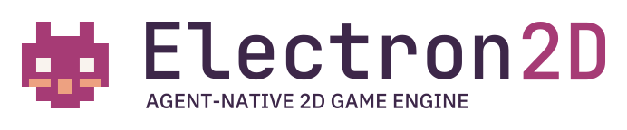
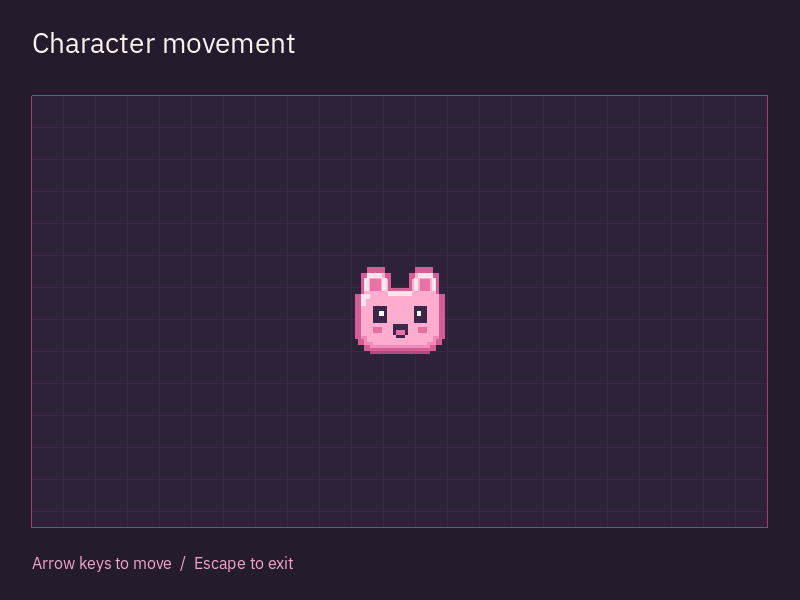

<p align="right"><a href="README.md">English</a> · <a href="README.ru.md">Русский</a> · <a href="README.zh-CN.md">简体中文</a> · Español · <a href="README.pt-BR.md">Português (BR)</a></p>

<h1 align="center">
  <picture>
    <source media="(prefers-color-scheme: dark) and (max-width: 480px)" srcset="docs/design/assets/sprite/logo-compact-dark.svg">
    <source media="(prefers-color-scheme: light) and (max-width: 480px)" srcset="docs/design/assets/sprite/logo-compact-light.svg">
    <source media="(prefers-color-scheme: dark)" srcset="docs/design/assets/sprite/logo-primary-dark.svg">
    <source media="(prefers-color-scheme: light)" srcset="docs/design/assets/sprite/logo-primary-light.svg">
    
  </picture>
</h1>

<p align="center">
  <a href="#installation"></a>
  <a href="#license"></a>
  <a href="https://github.com/edwardgushchin/Electron2D/releases"></a>
</p>

<p align="center">
  <a href="https://github.com/edwardgushchin/Electron2D/commits/main"></a>
  <a href="https://github.com/edwardgushchin/Electron2D/actions/workflows/ci.yml"></a>
  <a href="https://github.com/edwardgushchin/Electron2D/actions/workflows/ci.yml"></a>
</p>

<p align="center">
  <a href="#quick-start">Empezar</a> ·
  <a href="#features">Funciones</a> ·
  <a href="#platforms">Plataformas</a> ·
  <a href="#documentation">Documentación</a> ·
  <a href="#feedback-and-contributing">Participar</a>
</p>

<p align="center">⭐ <a href="https://github.com/edwardgushchin/Electron2D">Danos una estrella en GitHub</a> - ¡nos motiva mucho!</p>

<a id="about"></a>

##  Acerca del proyecto

Electron2D es un **motor 2D libre y multiplataforma, escrito en C#, para crear juegos en colaboración con agentes de IA**.

Crea mundos y mecánicas de juego con las herramientas habituales de .NET. Codex, Claude Code y otros asistentes de IA pueden ayudarte con el código.

<a id="features"></a>

##  Funciones

Este es un resumen de las principales funciones ya implementadas en el motor. Las API de los subsistemas siguen evolucionando; los enlaces describen su alcance y sus limitaciones.

- [Gráficos](docs/domains/rendering.md). Sprites y atlas, cámaras y paralaje, formas y texto, recorte, viewports fuera de pantalla, iluminación, sombras y HDR. Materiales HLSL/GLSL, grafos visuales de shaders y partículas CPU/GPU.
- [Escenas](docs/domains/scene.md). Jerarquías de nodos, escenas reutilizables y enlazadas, grupos, eventos, llamadas diferidas y temporizadores. Crea escenas en C#, guárdalas con sus recursos y vuelve a instanciarlas.
- [Animación](docs/components/scene-animation.md). Pistas por fotogramas y propiedades, curvas Bézier, tweens, grafos de mezcla y máquinas de estados. Los [esqueletos e IK](docs/components/skeletal-animation.md) animan huesos y deforman polígonos y mallas con pesos.
- [Mallas](docs/components/meshes.md) y [mapas de teselas](docs/components/tiles.md). Geometría indexada y procedural, instancias de mallas, atlas animados, conexiones de terreno y cuadrículas cuadradas, isométricas o hexagonales con capas de colisión y navegación.
- [Física](docs/domains/physics.md). Backends de CPU y GPU independiente, cuerpos rígidos y personajes, áreas, fuerzas, articulaciones y resortes. Consultas de rayos y formas, detección continua de colisiones y [puntos de control del estado](docs/components/physics-space-checkpoints.md).
- [Interfaz de juego](docs/domains/scene.md) y [texto](docs/components/text.md). Botones, menús, listas, árboles, contenedores, desplazamiento, editores de texto y código y texto enriquecido. Temas, composición Unicode, texto bidireccional y fuentes alternativas.
- [Audio](docs/domains/audio.md). WAV, MP3 y Ogg Vorbis, flujos procedurales, micrófono y audio posicional. Buses de audio, mezcla, efectos y grabación.
- [Reproducción de vídeo](docs/components/video-playback.md) y [grabación de películas](docs/components/movie-writing.md). Vídeo Ogg Theora con audio; captura sin tiempo real de fotogramas renderizados y audio mezclado en PNG/WAV, AVI u OGV.
- [Controles](docs/domains/input.md). Teclado, ratón, entrada táctil, mandos, asignación de acciones, atajos y entrada de texto con composición IME.
- [Ventanas y pantallas](docs/domains/display.md). Modos de ventana y pantalla completa, varios viewports, ventanas emergentes integradas y nativas, consultas de pantalla, escalado y controles de presentación.
- [Navegación](docs/domains/navigation.md). Búsqueda A-star en grafos y cuadrículas, regiones poligonales, enlaces, generación de navegación desde geometría, seguimiento de rutas por agentes y evasión recíproca de obstáculos.
- [Recursos](docs/domains/resources.md). Carga y guardado tipados, carga en segundo plano, imágenes, fuentes, audio, gradientes, curvas y texturas de ruido. Los [paquetes PCK/ZIP](docs/components/resource-packs.md) montan archivos en el sistema de recursos.
- [Servicios básicos y archivos](docs/domains/core.md). Ajustes del proyecto, JSON/XML y configuración, directorios, compresión, cifrado y archivos ZIP. Matemáticas, números aleatorios, tareas en segundo plano y diagnóstico de ejecución.
- [Localización](docs/domains/localization.md). Dominios y contextos de traducción, catálogos PO/MO, idiomas de respaldo, reglas plurales enteras, pseudolocalización y selección de recursos localizados.
- [Redes](docs/domains/networking.md). TCP/UDP y sockets locales, TLS/DTLS, HTTP/HTTPS, WebSocket y ENet. [Canales de datos WebRTC](docs/components/webrtc.md), RPC tipadas, autoridad, creación de objetos en red y [replicación de propiedades](docs/components/scene-replication.md).
- [Proyecto compartido](docs/components/project-jobs.md). Crea/abre un proyecto, edita una escena y código C# compartidos sin guardar, compila y ejecuta instantáneas inmutables y revisa capturas con su estado de vigencia. Los trabajos requieren Linux; la captura exige ventana y renderizador nativos.
- [Agente en el editor](docs/components/project-agent.md). El panel nativo de tareas y conversación conecta la versión verificada de Codex CLI a los documentos compartidos sin guardar mediante operaciones MCP autenticadas, con historial protegido, cancelación, reconexión y capturas reales. El perfil actual requiere Linux y una sesión iniciada en CLI.

Los materiales con shaders, las partículas GPU, la iluminación con sombras y HDR requieren el renderizador GPU; el renderizador de compatibilidad ofrece el perfil 2D descrito en su documentación. El backend de física se elige independientemente del renderizador. Consulta la documentación enlazada y el [informe de plataformas](docs/platform-verification.md) para conocer el alcance y las limitaciones de las verificaciones.

<a id="quick-start"></a>

##  Inicio rápido

Empieza con [CharacterMovement](examples/CharacterMovement/README.md). Mueve el personaje con las flechas en un ordenador, arrástralo con el dedo en un teléfono o usa los botones de dirección del mando en un televisor. El mismo ejemplo está preparado para todas las plataformas del motor.

<a id="installation"></a>

### Requisitos

- [SDK de .NET 10](https://dotnet.microsoft.com/download/dotnet/10.0). Git solo es necesario para compilar desde el código fuente.

Instala mediante NuGet el paquete principal `Electron2D` y el paquete de tu plataforma con los [comandos de la tabla siguiente](#use-electron2d-in-your-game). NuGet restaura las dependencias nativas automáticamente. [Reglas de versiones de los paquetes de plataforma](docs/native-packaging.md).

Los paquetes preliminares requieren `--prerelease`. Usa versiones coincidentes del motor y los paquetes de plataforma. Las versiones publicadas están en [NuGet](https://www.nuget.org/packages/Electron2D).

### Compilar y ejecutar

Para crear tu propio proyecto, consulta [Crear un proyecto de juego](#use-electron2d-in-your-game). Los comandos siguientes compilan y ejecutan el ejemplo del repositorio.

Para compilar desde el código fuente, clona el repositorio y compila la biblioteca:

```bash
git clone https://github.com/edwardgushchin/Electron2D.git
cd Electron2D
dotnet build Electron2D.csproj -c Release
```

Ejecuta el ejemplo en un ordenador:

```bash
dotnet run --project examples/CharacterMovement
```

Se abrirá una ventana fija de 800 × 600 con un personaje rosa sobre una cuadrícula. Las flechas lo mueven dentro del campo; Escape o cerrar la ventana termina la aplicación. La ventana y el personaje mantienen su tamaño. Prueba a cambiar la velocidad en `Player.cs` y ejecuta el ejemplo de nuevo.

En macOS, usa el [paquete de aplicación](examples/CharacterMovement/README.md#macos). El README del ejemplo incluye las instrucciones para [Android](examples/CharacterMovement/README.md#android-phone-or-tablet), [Android TV](examples/CharacterMovement/README.md#android-tv), [Web](examples/CharacterMovement/README.md#web), [iOS](examples/CharacterMovement/README.md#ios) y [Apple TV](examples/CharacterMovement/README.md#apple-tv-tvos).



[Código del ejemplo](examples/CharacterMovement/CharacterMovementScene.cs) · [Instrucciones de ejecución](examples/CharacterMovement/README.md)

<a id="use-electron2d-in-your-game"></a>

### Crear un proyecto de juego

Para un juego destinado a Windows, Linux o macOS, crea un proyecto de consola de .NET 10 y añade el paquete del motor:

```bash
dotnet new console -n MyGame --framework net10.0
cd MyGame
dotnet add package Electron2D --prerelease
```

También puedes usar el código fuente del motor. En ese caso, ejecuta estos comandos desde la raíz del repositorio:

```bash
dotnet new console -n MyGame -o ../MyGame --framework net10.0
dotnet add ../MyGame/MyGame.csproj reference Electron2D.csproj
cd ../MyGame
```

Después, instala el paquete de la plataforma objetivo:

| Plataforma | Comando |
| --- | --- |
| Windows | `dotnet add package Electron2D.Windows --prerelease` |
| Linux | `dotnet add package Electron2D.Linux --prerelease` |
| macOS | `dotnet add package Electron2D.MacOS --prerelease` |
| Web | `dotnet add package Electron2D.Web --prerelease` |
| Android y Android TV | `dotnet add package Electron2D.Android --prerelease` |
| iOS | `dotnet add package Electron2D.iOS --prerelease` |
| Apple TV (tvOS) | `dotnet add package Electron2D.tvOS --prerelease` |

Para varios destinos, añade cada paquete de plataforma necesario. Web, Android, iOS y tvOS necesitan las cargas de trabajo de .NET correspondientes y puntos de entrada de aplicación para cada plataforma. Los paquetes de plataforma no incluyen proyectos de aplicación listos para usar. El ejemplo de consola siguiente es para Windows, Linux y macOS.

Sustituye el contenido de `Program.cs` por este código:

```csharp
using Electron2D;

var window = new Window
{
    Title = "Mi juego",
    Size = new Vector2i(800, 600)
};

return Engine.Run(window);
```

Ejecuta la aplicación:

```bash
dotnet build -c Release
dotnet run -c Release
```

Añade objetos del juego a la ventana con `AddChild`. El ejemplo anterior muestra la actualización por fotogramas y el manejo del teclado.

La compilación del motor genera `Electron2D.dll`. Al publicar el juego se incluyen la biblioteca del motor y las dependencias nativas; una publicación autónoma también incluye el entorno de ejecución de .NET.

#### Teléfonos, televisores y navegadores

Usa [CharacterMovement](examples/CharacterMovement/README.md#start-your-own-project) como proyecto inicial. Copia sus fuentes y archivos de plataforma a `examples/MyGame`, cambia el nombre del proyecto a `MyGame.csproj` y define tu propio identificador de aplicación. El README del ejemplo explica cómo copiarlo, configurar el icono e instalarlo en un dispositivo.

Después, elige un destino:

| Destino | Comando desde la raíz del repositorio | Instalación y ejecución |
| --- | --- | --- |
| Android, teléfono o tableta ARM64 | `dotnet build examples/MyGame/MyGame.csproj -c Release -r android-arm64` | [USB, APK y entrada táctil](examples/CharacterMovement/README.md#android-phone-or-tablet) |
| Android TV, ARM de 32 bits | `dotnet build examples/MyGame/MyGame.csproj -c Release -r android-arm` | [ADB por red y mando](examples/CharacterMovement/README.md#android-tv) |
| Web | `dotnet publish examples/MyGame/MyGame.csproj -c Release -r browser-wasm -o bin/my-game/web` | [Servidor HTTP y Chrome](examples/CharacterMovement/README.md#web) |
| iOS, simulador en un Mac ARM64 | `dotnet build examples/MyGame/MyGame.csproj -c Release -r iossimulator-arm64 -p:EnableCodeSigning=false` | [Simulador y aplicación firmada](examples/CharacterMovement/README.md#ios) |
| Apple TV, simulador en un Mac ARM64 | `dotnet build examples/MyGame/MyGame.csproj -c Release -r tvossimulator-arm64 -p:EnableCodeSigning=false` | [Simulador y dispositivo tvOS](examples/CharacterMovement/README.md#apple-tv-tvos) |

Los teléfonos y televisores también usan otras arquitecturas; el README del ejemplo enumera todas las opciones. Compilar iOS y tvOS requiere macOS y Xcode.

La aplicación ocupa toda la pantalla en teléfonos y televisores. En el navegador hay un botón de pantalla completa. El campo se adapta a la relación de aspecto, y el personaje, el texto y la cuadrícula se escalan juntos.

<a id="platforms"></a>

##  Plataformas

La tabla indica qué se ha comprobado en cada plataforma del juego. El editor visual está destinado a Windows, Linux y macOS.

| Plataforma objetivo del juego | Comprobado en este repositorio |
| --- | --- |
| Windows, x86 / x64 / ARM64 | Las suites completas sin interfaz y las comprobaciones disponibles de recorte/AOT pasaron en CI. El renderizado no se ha comprobado |
| Linux, x64 / ARM64 | Las suites completas sin interfaz y las comprobaciones de recorte/AOT pasaron en ambas arquitecturas. En x64 se comprobaron ventanas, entrada y renderizado con Wayland, y renderizado con XWayland. El renderizado en ARM64 no se ha comprobado |
| macOS, x64 / ARM64 | Las suites completas sin interfaz y las comprobaciones de recorte/AOT pasaron en CI. El renderizado no se ha comprobado |
| Android, teléfonos y tabletas | Se han comprobado el inicio de CharacterMovement, la pantalla completa y el arrastre táctil en un teléfono ARM64. Los materiales con shaders y la física se comprobaron por separado |
| Android TV | Se han comprobado CharacterMovement y los botones de dirección del mando en un televisor de 32 bits. El renderizador de compatibilidad y la física se comprobaron por separado |
| iOS y tvOS, dispositivos y simuladores | Los contratos nativos pasaron en los cuatro perfiles de simulador. Las aplicaciones para dispositivos se compilan sin firma; no se han comprobado la ejecución en dispositivos físicos ni el renderizado |
| Navegadores | Se han comprobado CharacterMovement, el diseño adaptable y las flechas en Chrome. El formato vertical y el arrastre táctil se comprobaron con emulación de teléfono; no se ha comprobado un navegador móvil físico. El renderizado y la física se comprobaron por separado |

Las comprobaciones de Android y navegador cubren el ejemplo en dispositivos concretos y en Chrome. Consulta la [distribución de bibliotecas nativas](docs/native-packaging.md) para saber cuáles están disponibles en tu plataforma.

Los indicadores de compilación y pruebas muestran el estado de las comprobaciones automáticas del código y las aplicaciones de prueba. La ejecución en dispositivos reales se comprueba por separado. [Detalles de las comprobaciones automáticas](docs/platform-verification.md#automated-rid-checks).

Consulta los modelos de dispositivos, los comandos y el alcance de las comprobaciones en el [informe de plataformas](docs/platform-verification.md).

<a id="development"></a>

##  Estado del proyecto

Electron2D está en fase alfa. Su API pública sigue evolucionando y puede cambiar entre versiones.

Puedes crear escenas en código, guardarlas con `PackedScene` y volver a cargarlas desde [archivos de recursos y escenas](docs/components/resource-files.md). El editor visual muestra por ahora una pantalla de inicio; la edición de proyectos de juego aún no está implementada.

<a id="documentation"></a>

##  Documentación

| Necesitas | Dónde consultar |
| --- | --- |
| Encontrar una clase o un método | [Referencia de la API](docs/inventory.md) |
| Entender un subsistema | [Índice de documentación](docs/README.md) |
| Preparar shaders | [Herramienta de importación de HLSL y GLSL](tools/shaders/README.md) |
| Compilar y ejecutar cambios sin guardar y revisar capturas | [Trabajos del proyecto compartido](docs/components/project-jobs.md) |
| Preparar una versión | [Procedimiento de publicación](docs/releasing.md) |

<a id="examples"></a>

Hay instrucciones independientes para reproducir las comprobaciones de [Android](tests/Electron2D.AndroidProbe/README.md) y [WebGPU](tests/Electron2D.WebGpuProbe/README.md). La prueba de WebGPU comprueba las capacidades del navegador por separado del motor.

<a id="feedback-and-contributing"></a>

##  Participa en el proyecto

[Hacer una pregunta](https://github.com/edwardgushchin/Electron2D/discussions/categories/q-a) · [Reportar un problema](https://github.com/edwardgushchin/Electron2D/issues/new/choose) · [Guía de contribución](CONTRIBUTING.md) · [Ayuda](SUPPORT.md) · [Código de conducta](CODE_OF_CONDUCT.md) · [Seguridad](SECURITY.md)

Informa de errores y propón funciones en [GitHub Issues](https://github.com/edwardgushchin/Electron2D/issues). En un informe de error, indica la versión o el commit del motor, el sistema operativo y el renderizador. Adjunta un ejemplo mínimo y la salida del error.

Envía correcciones mediante [pull requests](https://github.com/edwardgushchin/Electron2D/pulls). El proceso de trabajo está descrito en la [guía de contribución](CONTRIBUTING.md).

<a id="contributors"></a>

El proyecto está a cargo de [Eduard Gushchin](https://github.com/edwardgushchin). Todos los autores de cambios aparecen en la [página de colaboradores de GitHub](https://github.com/edwardgushchin/Electron2D/graphs/contributors).

<a id="license"></a>

##  Licencia

Electron2D se distribuye bajo la [licencia MIT](licence/Electron2D-LICENSE.txt). Puedes usar el motor en juegos comerciales; conserva el aviso de derechos de autor y el texto de la licencia.

Las licencias de las dependencias se enumeran en los [avisos de componentes de terceros](licence/THIRD_PARTY_NOTICES.md). Al distribuir el juego, incluye los textos de licencia que exijan esas dependencias desde el directorio `licence/`.
