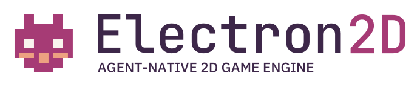
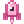
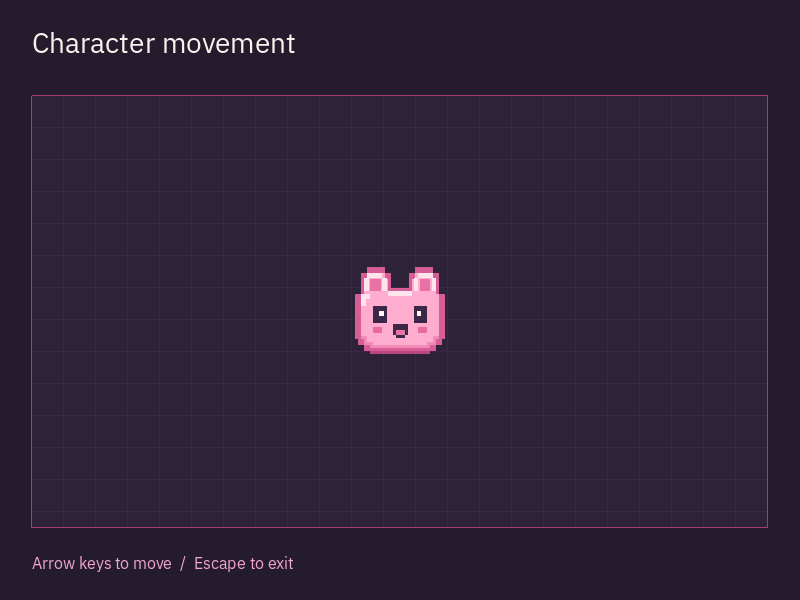
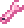

<p align="right"><a href="README.md">English</a> · <a href="README.ru.md">Русский</a> · <a href="README.zh-CN.md">简体中文</a> · Español · <a href="README.pt-BR.md">Português (BR)</a></p>

<h1 align="center">
  <picture>
    <source media="(prefers-color-scheme: dark) and (max-width: 480px)" srcset="docs/design/assets/sprite/logo-compact-dark.svg">
    <source media="(prefers-color-scheme: light) and (max-width: 480px)" srcset="docs/design/assets/sprite/logo-compact-light.svg">
    <source media="(prefers-color-scheme: dark)" srcset="docs/design/assets/sprite/logo-primary-dark.svg">
    <source media="(prefers-color-scheme: light)" srcset="docs/design/assets/sprite/logo-primary-light.svg">
    
  </picture>
</h1>

<p align="center">
  <a href="#installation"></a>
  <a href="#license"></a>
  <a href="https://github.com/edwardgushchin/Electron2D/releases"></a>
</p>

<p align="center">
  <a href="https://github.com/edwardgushchin/Electron2D/commits/main"></a>
  <a href="https://github.com/edwardgushchin/Electron2D/actions/workflows/ci.yml"></a>
  <a href="https://github.com/edwardgushchin/Electron2D/actions/workflows/ci.yml"></a>
</p>

<p align="center">
  <a href="#quick-start">Empezar</a> ·
  <a href="#philosophy">Filosofía</a> ·
  <a href="#features">Funciones</a> ·
  <a href="#platforms">Plataformas</a> ·
  <a href="#documentation">Documentación</a> ·
  <a href="#feedback-and-contributing">Participar</a>
</p>

<p align="center">⭐ <a href="https://github.com/edwardgushchin/Electron2D">Danos una estrella en GitHub</a> - ¡nos motiva mucho!</p>

<a id="about"></a>

##  Acerca del proyecto

Electron2D es un **motor 2D libre y multiplataforma, escrito en C#, para crear juegos en colaboración entre desarrolladores y agentes de IA**.

Crea mundos y mecánicas de juego con las herramientas habituales de .NET, por tu cuenta o con un asistente de programación.

<a id="philosophy"></a>

## Filosofía

Electron2D se basa en un **árbol de nodos — node-tree**. Un nodo puede representar un personaje, una imagen, una fuente de sonido, un temporizador o un elemento de interfaz. Al combinar nodos defines la composición de un objeto del juego; el motor proporciona el ciclo de vida de la jerarquía activa, el procesamiento de fotogramas y la entrada.

Por ejemplo, un personaje puede constar de estas partes:

```text
Player (CharacterBody)
├── Sprite
├── CollisionShape
├── AudioStreamPlayer
└── Timer
```

El movimiento y las colisiones del personaje, su imagen, sonido y temporizador se reparten entre nodos. Puedes sustituir la parte visual, añadir un arma o cambiar el sonido conservando el resto de la estructura. El árbol permite ver la composición del objeto y separar las responsabilidades de sus partes.

Una rama del árbol puede convertirse en una **escena reutilizable**, guardarse e instanciarse en distintas partes del juego. Una escena puede ser un botón, un arma, un enemigo o un nivel completo. Las escenas pequeñas se combinan para formar sistemas de juego más grandes.

Tres principios complementan este enfoque:

- **C# convencional con tipado estático.** La lógica del juego utiliza clases, propiedades y eventos de .NET. Las herramientas habituales del IDE ayudan a detectar errores de tipos, explorar la API y modificar el código.
- **Enfoque en 2D.** Las escenas, cámaras, gráficos, física y herramientas se diseñan para las necesidades de los juegos bidimensionales.
- **Un proyecto compartido entre personas y agentes.** La arquitectura está diseñada para trabajar con las mismas escenas, recursos y código mediante operaciones comunes de edición, compilación, ejecución y verificación de resultados.

<a id="features"></a>

##  Funciones

Las escenas y la lógica del juego se crean en C#. Para las demás tareas dispones de las siguientes herramientas.

### Mundos, imagen y mecánicas de juego

- **[Escenas y niveles](docs/domains/scene.md).** Construye personajes, objetos y niveles a partir de jerarquías de nodos; guarda las escenas y vuelve a instanciarlas. Hay eventos, grupos, temporizadores y llamadas diferidas para la lógica.
- **[Gráficos y cámaras](docs/domains/rendering.md).** Sprites y atlas, formas y texto, paralaje, recorte y viewports independientes para mundos de juego, minimapas y vistas de varias cámaras.
- **[Shaders y efectos](docs/components/shader-materials.md).** Materiales HLSL/GLSL, [grafos visuales de shaders](docs/components/visual-shaders.md), iluminación, sombras, HDR y partículas CPU/GPU permiten definir el aspecto de los objetos y del entorno.
- **[Mapas](docs/components/tiles.md) y [geometría](docs/components/meshes.md).** Cuadrículas cuadradas, isométricas y hexagonales, teselas animadas, conexiones de terreno y capas de colisión y navegación. Las mallas pueden generarse de forma procedural y dibujarse en múltiples instancias.
- **[Animación](docs/components/scene-animation.md).** Animación por fotogramas y propiedades, curvas Bézier, tweens, mezcla y máquinas de estados; los [esqueletos e IK](docs/components/skeletal-animation.md) permiten trabajar con huesos y deformar personajes.
- **[Física](docs/domains/physics.md).** Un backend de CPU y un backend GPU independiente: cuerpos rígidos, personajes controlables, áreas de activación, fuerzas, articulaciones y resortes. Las consultas de rayos y formas ayudan a comprobar el entorno y las colisiones.
- **[Búsqueda de rutas](docs/domains/navigation.md).** A-star sobre grafos o cuadrículas, regiones y enlaces de navegación, generación de navegación desde geometría, seguimiento de rutas y evasión de obstáculos para mover personajes.

### Interfaz e interacción con el jugador

- **[Interfaz y texto](docs/domains/scene.md).** Construye menús, HUD, inventarios y diálogos con botones, listas, árboles, contenedores y campos de texto. Hay temas, desplazamiento, editores de texto y código, texto enriquecido, Unicode, composición bidireccional y fuentes alternativas.
- **[Controles](docs/domains/input.md) y [ventanas](docs/domains/display.md).** Teclado, ratón, entrada táctil, mandos, asignación de acciones y entrada IME. Modos de ventana y pantalla completa, escalado, varias ventanas y ventanas emergentes integradas o nativas.
- **[Audio](docs/domains/audio.md) y [vídeo](docs/components/video-playback.md).** Audio posicional, buses, mezcla, efectos, micrófono y flujos procedurales; reproducción de Ogg Theora con audio. La [grabación de películas](docs/components/movie-writing.md) guarda fotogramas y audio en PNG/WAV, AVI u OGV sin depender del tiempo real.
- **[Localización](docs/domains/localization.md) y [accesibilidad](docs/components/accessibility.md).** Traducciones, contextos, formas plurales, catálogos PO/MO y recursos localizados. AT-SPI en Linux publica la semántica de la interfaz y admite acciones, texto y desplazamiento; los adaptadores de otras plataformas siguen en desarrollo.

### Recursos, red y herramientas de desarrollo

- **[Recursos y guardado de escenas](docs/domains/resources.md).** Carga tipada y en segundo plano, guardado de escenas con sus recursos y [paquetes PCK/ZIP](docs/components/resource-packs.md). Imágenes, gradientes, curvas y texturas de ruido sirven de base para contenido procedural.
- **[Archivos, ajustes y tareas en segundo plano](docs/domains/core.md).** JSON/XML, archivos de configuración y entrada/salida de archivos para ajustes y datos de partidas guardadas. Hay compresión, cifrado, archivos ZIP, matemáticas, números aleatorios, hilos de trabajo y diagnóstico de ejecución.
- **[Red y multijugador](docs/domains/networking.md).** TCP/UDP, TLS/DTLS, HTTP/HTTPS, WebSocket, ENet y WebRTC. Los objetos de juegos en red disponen de RPC, autoridad de nodos, creación de objetos y [replicación de propiedades](docs/components/scene-replication.md).
- **[Cómputo y gráficos de bajo nivel en GPU](docs/components/local-compute.md).** RenderingDevice proporciona búferes, texturas y pipelines de cómputo y gráficos para algoritmos propios en GPU y procesamiento procedural de datos.
- **[Proyecto compartido y verificación de resultados](docs/components/project-jobs.md).** Escena y código C# compartidos sin guardar, historial de cambios, compilación y ejecución de instantáneas inmutables y captura de fotogramas reales. El perfil actual requiere Linux; la captura necesita una ventana nativa y un renderizador.

Los materiales de shaders, las partículas GPU, la iluminación con sombras y HDR requieren el renderizador GPU. El soporte depende de la plataforma y del backend elegido; las capacidades y limitaciones exactas se describen en los enlaces y en el [informe de plataformas](docs/platform-verification.md).

<a id="agent-support"></a>

## Proveedores y clientes de agentes

Se ha verificado un flujo limitado de integración del editor con Codex CLI en Linux. El soporte de otros clientes está en desarrollo; las capacidades actuales y los planes figuran en la [tabla de soporte](docs/components/project-agent.md#provider-and-client-support).

El desarrollo habitual y la compilación del juego no requieren un agente.

<a id="quick-start"></a>

##  Inicio rápido

<a id="installation"></a>

Instala [.NET 10 SDK](https://dotnet.microsoft.com/download/dotnet/10.0) y Git. Después ejecuta el ejemplo en Windows, Linux o macOS:

```bash
git clone https://github.com/edwardgushchin/Electron2D.git
cd Electron2D
dotnet run --project examples/CharacterMovement
```

Se abrirá una escena con un personaje sobre una cuadrícula. Muévete con las flechas; cambia la velocidad en `Player.cs` y vuelve a ejecutar el ejemplo.

<a id="examples"></a>



<a id="use-electron2d-in-your-game"></a>

La creación de tu propio juego y la ejecución en teléfonos, televisores o navegadores se explican en la [guía de CharacterMovement](examples/CharacterMovement/README.md).

<a id="platforms"></a>

##  Plataformas

| Plataforma | Estado actual de las verificaciones |
| --- | --- |
| Windows | Pruebas automatizadas; la aceptación visual aún no está completa |
| Linux | Ventana, entrada y renderizado verificados en x64; pruebas automatizadas en ARM64 |
| macOS | Pruebas automatizadas; la aceptación visual aún no está completa |
| Android | Inicio, escena y controles táctiles verificados en un teléfono ARM64 |
| Android TV | Inicio y control con mando verificados en un televisor de 32 bits |
| iOS | Pruebas de bibliotecas nativas en simuladores; renderizado y dispositivos físicos aún sin verificar |
| tvOS | Pruebas de bibliotecas nativas en simuladores; renderizado y dispositivos físicos aún sin verificar |
| Web | Ejemplo y entrada verificados en Chrome local |

Las configuraciones y limitaciones exactas figuran en el [informe de plataformas](docs/platform-verification.md).

<a id="development"></a>

##  Estado del proyecto

**Alpha:** la API pública evoluciona y puede cambiar entre versiones.

Los juegos se pueden crear en C#. El editor visual está en desarrollo; los flujos disponibles se describen en la [documentación del editor](docs/components/project-jobs.md).

<a id="documentation"></a>

##  Documentación

- [Guías de subsistemas](docs/README.md)
- [Referencia de la API](docs/inventory.md)
- [Preparación de shaders](tools/shaders/README.md)

<a id="feedback-and-contributing"></a>

##  Participa en el proyecto

Comunica errores y propone funciones en [GitHub Issues](https://github.com/edwardgushchin/Electron2D/issues). Incluye un ejemplo mínimo, la versión del motor y los datos del sistema en los informes de errores.

<a id="contributors"></a>

El proceso de colaboración se describe en la [guía para colaboradores](CONTRIBUTING.md).

<a id="license"></a>

##  Licencia

[MIT](licence/Electron2D-LICENSE.txt). Puedes utilizar el motor en proyectos libres y comerciales. Las licencias de terceros están en el [directorio licence](licence).
