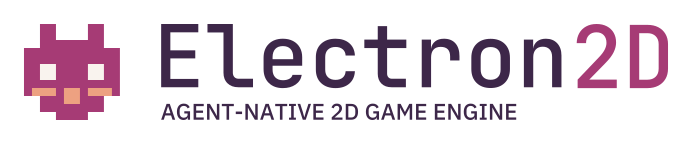
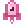
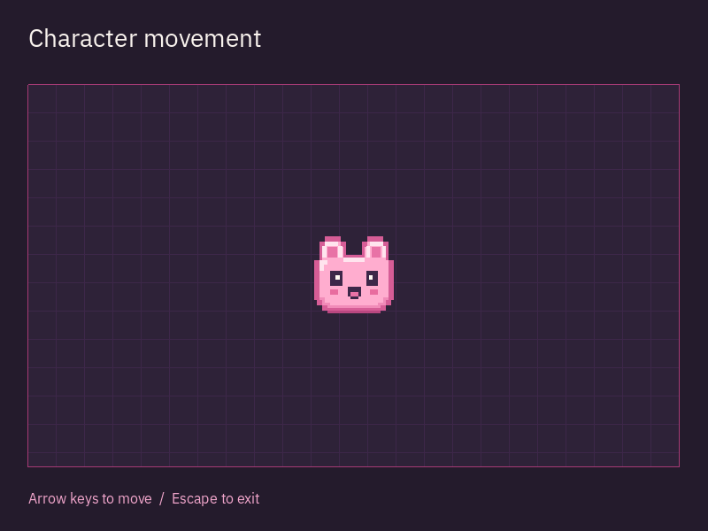

<p align="right">English · <a href="README.ru.md">Русский</a> · <a href="README.zh-CN.md">简体中文</a> · <a href="README.es.md">Español</a> · <a href="README.pt-BR.md">Português (BR)</a></p>

<h1 align="center">
  <picture>
    <source media="(prefers-color-scheme: dark) and (max-width: 480px)" srcset="docs/design/assets/sprite/logo-compact-dark.svg">
    <source media="(prefers-color-scheme: light) and (max-width: 480px)" srcset="docs/design/assets/sprite/logo-compact-light.svg">
    <source media="(prefers-color-scheme: dark)" srcset="docs/design/assets/sprite/logo-primary-dark.svg">
    <source media="(prefers-color-scheme: light)" srcset="docs/design/assets/sprite/logo-primary-light.svg">
    
  </picture>
</h1>

<p align="center">
  <a href="#installation"></a>
  <a href="#license"></a>
  <a href="https://github.com/edwardgushchin/Electron2D/releases"></a>
</p>

<p align="center">
  <a href="https://github.com/edwardgushchin/Electron2D/commits/main"></a>
  <a href="https://github.com/edwardgushchin/Electron2D/actions/workflows/ci.yml"></a>
  <a href="https://github.com/edwardgushchin/Electron2D/actions/workflows/ci.yml"></a>
</p>

<p align="center">
  <a href="#quick-start">Get started</a> ·
  <a href="#philosophy">Philosophy</a> ·
  <a href="#features">Features</a> ·
  <a href="#platforms">Platforms</a> ·
  <a href="#documentation">Documentation</a> ·
  <a href="#feedback-and-contributing">Contribute</a>
</p>

<p align="center">⭐ <a href="https://github.com/edwardgushchin/Electron2D">Star us on GitHub</a> - it motivates us a lot!</p>

<a id="about"></a>

##  About

Electron2D is a **free and open-source cross-platform 2D engine written in C# for developers and AI agents to build games together**.

Build game worlds and mechanics with familiar .NET tools, on your own or with a coding assistant.

<a id="philosophy"></a>

## Philosophy

Electron2D is built around a **tree of nodes — a node-tree**. A node can represent a character, an image, a sound source, a timer or a UI element. Combining nodes defines the structure of a game object; the engine provides the active hierarchy's lifecycle, frame processing and input.

For example, a character can consist of these parts:

```text
Player (CharacterBody)
├── Sprite
├── CollisionShape
├── AudioStreamPlayer
└── Timer
```

The character's movement and collisions, visuals, sound and timer are divided between nodes. You can replace the visuals, add a weapon or change the sound while keeping the rest of the structure. The tree makes the object's composition visible and helps separate the responsibilities of its parts.

A branch of the tree can become a **reusable scene**, saved and instantiated in different parts of the game. A scene can be a button, a weapon, an enemy or an entire level. Small scenes combine into larger game systems.

Three principles complement this approach:

- **Standard, strongly typed C#.** Game logic uses .NET classes, properties and events. Familiar IDE tools help catch type errors, explore the API and change code.
- **A focus on 2D.** Scenes, cameras, graphics, physics and tools are designed around the needs of two-dimensional games.
- **One project for humans and agents.** The architecture is designed for working with the same scenes, resources and code through shared editing, build, run and result-verification operations.

<a id="features"></a>

##  Features

Scenes and game logic are created in C#. The following tools support the other parts of your game.

### Worlds, visuals and game mechanics

- **[Scenes and levels](docs/domains/scene.md).** Build characters, items and levels from node hierarchies; save and instantiate scenes again. Events, groups, timers and deferred calls support game logic.
- **[Graphics and cameras](docs/domains/rendering.md).** Sprites and atlases, shapes and text, parallax, clipping and independent viewports support game worlds, minimaps and multiple camera views.
- **[Shaders and effects](docs/components/shader-materials.md).** HLSL/GLSL materials, [visual shader graphs](docs/components/visual-shaders.md), lighting, shadows, HDR and CPU/GPU particles let you define the appearance of objects and environments.
- **[Maps](docs/components/tiles.md) and [geometry](docs/components/meshes.md).** Square, isometric and hexagonal grids, animated tiles, terrain connections, collision and navigation layers. Meshes can be generated procedurally and drawn as many instances.
- **[Animation](docs/components/scene-animation.md).** Frame and property animation, Bézier curves, tweens, blending and state machines; [skeletons and IK](docs/components/skeletal-animation.md) support bones and character deformation.
- **[Physics](docs/domains/physics.md).** CPU and independent GPU backends provide rigid bodies, controllable characters, trigger areas, forces, joints and springs. Ray and shape queries help inspect surroundings and collisions.
- **[Pathfinding](docs/domains/navigation.md).** A-star on graphs or grids, navigation regions and links, navigation baking from geometry, path following and obstacle avoidance support character movement.

### Interface and player interaction

- **[UI and text](docs/domains/scene.md).** Build menus, HUDs, inventories and dialogs from buttons, lists, trees, containers and text fields. Themes, scrolling, text/code editors, rich text, Unicode, bidirectional layout and font fallbacks are available.
- **[Input](docs/domains/input.md) and [windows](docs/domains/display.md).** Keyboard, mouse, touch, controllers, action mappings and IME input. Windowed and fullscreen modes, scaling, multiple windows and embedded or native popups.
- **[Audio](docs/domains/audio.md) and [video](docs/components/video-playback.md).** Positional audio, buses, mixing, effects, microphone input and procedural streams; Ogg Theora playback with audio. [Movie recording](docs/components/movie-writing.md) saves frames and audio to PNG/WAV, AVI or OGV without a real-time constraint.
- **[Localization](docs/domains/localization.md) and [accessibility](docs/components/accessibility.md).** Translations, contexts, plural forms, PO/MO catalogs and localized resources. Linux AT-SPI exposes UI semantics and supports actions, text and scrolling; other platform adapters remain in development.

### Resources, networking and developer tools

- **[Resources and scene saving](docs/domains/resources.md).** Typed and background loading, scenes saved with their resources, and [PCK/ZIP packs](docs/components/resource-packs.md). Images, gradients, curves and noise textures provide building blocks for procedural content.
- **[Files, settings and background tasks](docs/domains/core.md).** JSON/XML, configuration files and file I/O support settings and saved-game data. Compression, encryption, ZIP archives, math, random generation, worker threads and runtime diagnostics are available.
- **[Networking and multiplayer](docs/domains/networking.md).** TCP/UDP, TLS/DTLS, HTTP/HTTPS, WebSocket, ENet and WebRTC. Networked game objects can use RPC, node authority, spawning and [property replication](docs/components/scene-replication.md).
- **[GPU compute and low-level graphics](docs/components/local-compute.md).** RenderingDevice provides buffers, textures, compute and graphics pipelines for custom GPU algorithms and procedural data processing.
- **[Shared project and result verification](docs/components/project-jobs.md).** Shared unsaved scenes and C# code, change history, immutable snapshot builds/runs and capture of real frames. The current profile requires Linux; capture needs a native window and renderer.

Shader materials, GPU particles, lighting with shadows and HDR require the GPU renderer. Support depends on the platform and selected backend; exact capabilities and limits are documented in the links above and the [platform report](docs/platform-verification.md).

<a id="agent-support"></a>

## Agent providers and clients

A bounded editor integration workflow with Codex CLI has been verified on Linux. Support for other clients is in development; current capabilities and plans are listed in the [support matrix](docs/components/project-agent.md#provider-and-client-support).

Ordinary development and game builds do not require an agent.

<a id="quick-start"></a>

##  Quick start

<a id="installation"></a>

Install [.NET 10 SDK](https://dotnet.microsoft.com/download/dotnet/10.0) and Git. Then run the example on Windows, Linux or macOS:

```bash
git clone https://github.com/edwardgushchin/Electron2D.git
cd Electron2D
dotnet run --project examples/CharacterMovement
```

A scene opens with a character on a grid. Move with the arrow keys; change the speed in `Player.cs` and run the example again.

<a id="examples"></a>



<a id="use-electron2d-in-your-game"></a>

Creating your own game and running on a phone, TV or browser are covered in the [CharacterMovement guide](examples/CharacterMovement/README.md).

<a id="platforms"></a>

##  Platforms

| Platform | Current verification status |
| --- | --- |
| Windows | Automated checks; visual acceptance is not yet complete |
| Linux | Window, input and rendering verified on x64; automated checks on ARM64 |
| macOS | Automated checks; visual acceptance is not yet complete |
| Android | Startup, scene and touch controls verified on an ARM64 phone |
| Android TV | Startup and remote controls verified on one 32-bit TV |
| iOS | Native-library checks in simulators; rendering and physical devices are not yet verified |
| tvOS | Native-library checks in simulators; rendering and physical devices are not yet verified |
| Web | Example and input verified in local Chrome |

Exact configurations and limits are listed in the [platform report](docs/platform-verification.md).

<a id="development"></a>

##  Project status

**Alpha:** the public API is evolving and may change between releases.

Games can be created in C#. The visual editor is in development; available workflows are described in the [editor documentation](docs/components/project-jobs.md).

<a id="documentation"></a>

##  Documentation

- [Subsystem guides](docs/README.md)
- [API reference](docs/inventory.md)
- [Shader preparation](tools/shaders/README.md)

<a id="feedback-and-contributing"></a>

##  Contributing

Report bugs and suggest features in [GitHub Issues](https://github.com/edwardgushchin/Electron2D/issues). Include a minimal example, engine version and system details in bug reports.

<a id="contributors"></a>

The contribution process is described in the [contributor guide](CONTRIBUTING.md).

<a id="license"></a>

##  License

[MIT](licence/Electron2D-LICENSE.txt). You can use the engine in open-source and commercial projects. Third-party licenses are in the [licence directory](licence).
