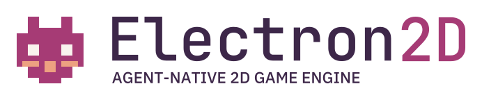
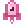
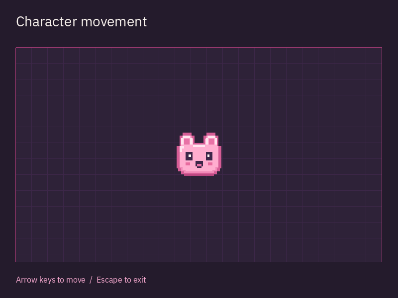

<p align="right"><a href="README.md">English</a> · <a href="README.ru.md">Русский</a> · <a href="README.zh-CN.md">简体中文</a> · <a href="README.es.md">Español</a> · Português (BR)</p>

<h1 align="center">
  <picture>
    <source media="(prefers-color-scheme: dark) and (max-width: 480px)" srcset="docs/design/assets/sprite/logo-compact-dark.svg">
    <source media="(prefers-color-scheme: light) and (max-width: 480px)" srcset="docs/design/assets/sprite/logo-compact-light.svg">
    <source media="(prefers-color-scheme: dark)" srcset="docs/design/assets/sprite/logo-primary-dark.svg">
    <source media="(prefers-color-scheme: light)" srcset="docs/design/assets/sprite/logo-primary-light.svg">
    
  </picture>
</h1>

<p align="center">
  <a href="#installation"></a>
  <a href="#license"></a>
  <a href="https://github.com/edwardgushchin/Electron2D/releases"></a>
</p>

<p align="center">
  <a href="https://github.com/edwardgushchin/Electron2D/commits/main"></a>
  <a href="https://github.com/edwardgushchin/Electron2D/actions/workflows/ci.yml"></a>
  <a href="https://github.com/edwardgushchin/Electron2D/actions/workflows/ci.yml"></a>
</p>

<p align="center">
  <a href="#quick-start">Começar</a> ·
  <a href="#philosophy">Filosofia</a> ·
  <a href="#features">Recursos</a> ·
  <a href="#platforms">Plataformas</a> ·
  <a href="#documentation">Documentação</a> ·
  <a href="#feedback-and-contributing">Contribuir</a>
</p>

<p align="center">⭐ <a href="https://github.com/edwardgushchin/Electron2D">Dê uma estrela no GitHub</a> - isso nos motiva muito!</p>

<a id="about"></a>

##  Sobre o projeto

Electron2D é um **motor 2D livre e multiplataforma em C# para desenvolver jogos em colaboração entre pessoas e agentes de IA**.

Crie mundos e mecânicas de jogo com as ferramentas habituais do .NET, por conta própria ou com um assistente de programação.

<a id="philosophy"></a>

## Filosofia

Electron2D se baseia em uma **árvore de nós — node-tree**. Um nó pode representar um personagem, uma imagem, uma fonte de som, um temporizador ou um elemento de interface. Ao combinar nós, você define a composição de um objeto do jogo; o motor fornece o ciclo de vida da hierarquia ativa, o processamento de quadros e a entrada.

Por exemplo, um personagem pode ser composto por estas partes:

```text
Player (CharacterBody)
├── Sprite
├── CollisionShape
├── AudioStreamPlayer
└── Timer
```

O movimento e as colisões do personagem, sua imagem, som e temporizador são divididos entre nós. Você pode substituir a parte visual, adicionar uma arma ou mudar o som, mantendo o restante da estrutura. A árvore torna a composição do objeto visível e ajuda a separar as responsabilidades de suas partes.

Um ramo da árvore pode se tornar uma **cena reutilizável**, ser salvo e instanciado em diferentes partes do jogo. Uma cena pode ser um botão, uma arma, um inimigo ou um nível inteiro. Cenas pequenas se combinam para formar sistemas de jogo maiores.

Três princípios complementam essa abordagem:

- **C# convencional com tipagem estática.** A lógica do jogo usa classes, propriedades e eventos do .NET. As ferramentas habituais do IDE ajudam a encontrar erros de tipo, explorar a API e alterar o código.
- **Foco em 2D.** Cenas, câmeras, gráficos, física e ferramentas são projetados para as necessidades dos jogos bidimensionais.
- **Um projeto compartilhado por pessoas e agentes.** A arquitetura foi pensada para trabalhar com as mesmas cenas, recursos e código por meio de operações comuns de edição, compilação, execução e verificação de resultados.

<a id="features"></a>

##  Recursos

As cenas e a lógica do jogo são criadas em C#. Para as demais tarefas, estão disponíveis as seguintes ferramentas.

### Mundos, imagem e mecânicas de jogo

- **[Cenas e níveis](docs/domains/scene.md).** Monte personagens, itens e níveis a partir de hierarquias de nós; salve as cenas e crie novas instâncias. Há eventos, grupos, temporizadores e chamadas adiadas para a lógica.
- **[Gráficos e câmeras](docs/domains/rendering.md).** Sprites e atlas, formas e texto, paralaxe, recorte e viewports independentes para mundos de jogo, minimapas e visualizações de várias câmeras.
- **[Shaders e efeitos](docs/components/shader-materials.md).** Materiais HLSL/GLSL, [grafos visuais de shaders](docs/components/visual-shaders.md), iluminação, sombras, HDR e partículas CPU/GPU permitem definir a aparência de objetos e ambientes.
- **[Mapas](docs/components/tiles.md) e [geometria](docs/components/meshes.md).** Grades quadradas, isométricas e hexagonais, tiles animados, conexões de terreno e camadas de colisão e navegação. As malhas podem ser geradas de forma procedural e desenhadas em várias instâncias.
- **[Animação](docs/components/scene-animation.md).** Animação de quadros e propriedades, curvas Bézier, tweens, mistura e máquinas de estados; [esqueletos e IK](docs/components/skeletal-animation.md) permitem trabalhar com ossos e deformar personagens.
- **[Física](docs/domains/physics.md).** Um backend de CPU e um backend GPU independente: corpos rígidos, personagens controláveis, áreas de gatilho, forças, juntas e molas. Consultas de raios e formas ajudam a verificar o ambiente e as colisões.
- **[Busca de caminhos](docs/domains/navigation.md).** A-star em grafos ou grades, regiões e conexões de navegação, geração de navegação a partir da geometria, acompanhamento de caminhos e desvio de obstáculos para mover personagens.

### Interface e interação com o jogador

- **[Interface e texto](docs/domains/scene.md).** Monte menus, HUDs, inventários e diálogos com botões, listas, árvores, contêineres e campos de texto. Há temas, rolagem, editores de texto e código, texto formatado, Unicode, layout bidirecional e fontes alternativas.
- **[Controles](docs/domains/input.md) e [janelas](docs/domains/display.md).** Teclado, mouse, toque, controles, mapeamento de ações e entrada IME. Modos de janela e tela cheia, escala, várias janelas e popups incorporados ou nativos.
- **[Áudio](docs/domains/audio.md) e [vídeo](docs/components/video-playback.md).** Áudio posicional, barramentos, mixagem, efeitos, microfone e fluxos procedurais; reprodução de Ogg Theora com áudio. A [gravação de filmes](docs/components/movie-writing.md) salva quadros e áudio em PNG/WAV, AVI ou OGV sem depender do tempo real.
- **[Localização](docs/domains/localization.md) e [acessibilidade](docs/components/accessibility.md).** Traduções, contextos, formas plurais, catálogos PO/MO e recursos localizados. AT-SPI no Linux expõe a semântica da interface e oferece ações, texto e rolagem; os adaptadores de outras plataformas continuam em desenvolvimento.

### Recursos, rede e ferramentas de desenvolvimento

- **[Recursos e salvamento de cenas](docs/domains/resources.md).** Carregamento tipado e em segundo plano, salvamento de cenas com seus recursos e [pacotes PCK/ZIP](docs/components/resource-packs.md). Imagens, gradientes, curvas e texturas de ruído servem de base para conteúdo procedural.
- **[Arquivos, configurações e tarefas em segundo plano](docs/domains/core.md).** JSON/XML, arquivos de configuração e entrada/saída de arquivos para configurações e dados de jogos salvos. Há compressão, criptografia, arquivos ZIP, matemática, números aleatórios, threads de trabalho e diagnóstico de execução.
- **[Rede e multijogador](docs/domains/networking.md).** TCP/UDP, TLS/DTLS, HTTP/HTTPS, WebSocket, ENet e WebRTC. Os objetos de jogos em rede contam com RPC, autoridade de nós, criação de objetos e [replicação de propriedades](docs/components/scene-replication.md).
- **[Computação e gráficos de baixo nível na GPU](docs/components/local-compute.md).** RenderingDevice fornece buffers, texturas e pipelines de computação e gráficos para algoritmos próprios na GPU e processamento procedural de dados.
- **[Projeto compartilhado e verificação de resultados](docs/components/project-jobs.md).** Cena e código C# compartilhados ainda não salvos, histórico de alterações, compilação e execução de snapshots imutáveis e captura de quadros reais. O perfil atual exige Linux; a captura precisa de uma janela nativa e um renderizador.

Materiais de shaders, partículas GPU, iluminação com sombras e HDR exigem o renderizador GPU. O suporte depende da plataforma e do backend escolhido; as capacidades e limitações exatas estão nos links e no [relatório de plataformas](docs/platform-verification.md).

<a id="agent-support"></a>

## Provedores e clientes de agentes

Um fluxo limitado de integração do editor com Codex CLI foi verificado no Linux. O suporte a outros clientes está em desenvolvimento; as capacidades atuais e os planos estão na [tabela de suporte](docs/components/project-agent.md#provider-and-client-support).

O desenvolvimento habitual e a compilação do jogo não exigem um agente.

<a id="quick-start"></a>

##  Primeiros passos

<a id="installation"></a>

Instale [.NET 10 SDK](https://dotnet.microsoft.com/download/dotnet/10.0) e Git. Depois execute o exemplo no Windows, Linux ou macOS:

```bash
git clone https://github.com/edwardgushchin/Electron2D.git
cd Electron2D
dotnet run --project examples/CharacterMovement
```

Uma cena será aberta com um personagem em uma grade. Mova-o com as setas; altere a velocidade em `Player.cs` e execute o exemplo novamente.

<a id="examples"></a>



<a id="use-electron2d-in-your-game"></a>

A criação do seu próprio jogo e a execução em celulares, TVs ou navegadores estão no [guia de CharacterMovement](examples/CharacterMovement/README.md).

<a id="platforms"></a>

##  Plataformas

| Plataforma | Estado atual das verificações |
| --- | --- |
| Windows | Verificações automatizadas; a aceitação visual ainda não foi concluída |
| Linux | Janela, entrada e renderização verificadas em x64; verificações automatizadas em ARM64 |
| macOS | Verificações automatizadas; a aceitação visual ainda não foi concluída |
| Android | Inicialização, cena e controles por toque verificados em um celular ARM64 |
| Android TV | Inicialização e controle remoto verificados em uma TV de 32 bits |
| iOS | Verificações de bibliotecas nativas em simuladores; renderização e dispositivos físicos ainda não verificados |
| tvOS | Verificações de bibliotecas nativas em simuladores; renderização e dispositivos físicos ainda não verificados |
| Web | Exemplo e entrada verificados no Chrome local |

As configurações e limitações exatas estão no [relatório de plataformas](docs/platform-verification.md).

<a id="development"></a>

##  Estado do projeto

**Alpha:** a API pública está evoluindo e pode mudar entre versões.

Os jogos podem ser criados em C#. O editor visual está em desenvolvimento; os fluxos disponíveis estão na [documentação do editor](docs/components/project-jobs.md).

<a id="documentation"></a>

##  Documentação

- [Guias dos subsistemas](docs/README.md)
- [Referência da API](docs/inventory.md)
- [Preparação de shaders](tools/shaders/README.md)

<a id="feedback-and-contributing"></a>

##  Contribua com o projeto

Relate erros e sugira recursos no [GitHub Issues](https://github.com/edwardgushchin/Electron2D/issues). Inclua um exemplo mínimo, a versão do motor e os dados do sistema nos relatos de erro.

<a id="contributors"></a>

O processo de contribuição está no [guia para colaboradores](CONTRIBUTING.md).

<a id="license"></a>

##  Licença

[MIT](licence/Electron2D-LICENSE.txt). Você pode usar o motor em projetos livres e comerciais. As licenças de terceiros estão no [diretório licence](licence).
