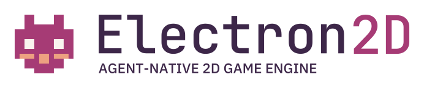
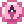
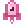
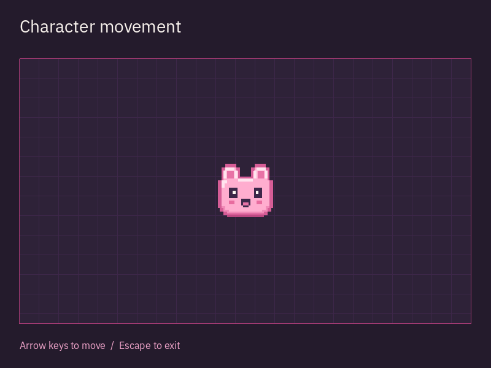
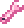
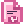

<p align="right"><a href="README.md">English</a> · Русский · <a href="README.zh-CN.md">简体中文</a> · <a href="README.es.md">Español</a> · <a href="README.pt-BR.md">Português (BR)</a></p>

<h1 align="center">
  <picture>
    <source media="(prefers-color-scheme: dark) and (max-width: 480px)" srcset="docs/design/assets/sprite/logo-compact-dark.svg">
    <source media="(prefers-color-scheme: light) and (max-width: 480px)" srcset="docs/design/assets/sprite/logo-compact-light.svg">
    <source media="(prefers-color-scheme: dark)" srcset="docs/design/assets/sprite/logo-primary-dark.svg">
    <source media="(prefers-color-scheme: light)" srcset="docs/design/assets/sprite/logo-primary-light.svg">
    
  </picture>
</h1>

<p align="center">
  <a href="#installation"></a>
  <a href="#license"></a>
  <a href="https://github.com/edwardgushchin/Electron2D/releases"></a>
</p>

<p align="center">
  <a href="https://github.com/edwardgushchin/Electron2D/commits/main"></a>
  <a href="https://github.com/edwardgushchin/Electron2D/actions/workflows/ci.yml"></a>
  <a href="https://github.com/edwardgushchin/Electron2D/actions/workflows/ci.yml"></a>
</p>

<p align="center">
  <a href="#quick-start">Начать</a> ·
  <a href="#philosophy">Философия</a> ·
  <a href="#features">Возможности</a> ·
  <a href="#platforms">Платформы</a> ·
  <a href="#documentation">Документация</a> ·
  <a href="#feedback-and-contributing">Участие</a>
</p>

<p align="center">⭐ <a href="https://github.com/edwardgushchin/Electron2D">Поставьте нам звезду на GitHub</a> - это мотивирует!</p>

<a id="about"></a>

##  О проекте

Electron2D — **свободный кроссплатформенный 2D-движок на C# для совместной разработки игр человеком и ИИ-агентами**.

Создавайте игровые миры и механики с привычными инструментами .NET, самостоятельно или вместе с помощником по коду.

<a id="philosophy"></a>

## Философия

Electron2D строится вокруг **дерева узлов — node-tree**. Узел может представлять персонажа, изображение, источник звука, таймер или элемент интерфейса. Соединяя узлы, вы задаёте состав игрового объекта; движок обеспечивает жизненный цикл активной иерархии, обработку кадров и ввод.

Например, персонаж может состоять из таких частей:

```text
Player (CharacterBody)
├── Sprite
├── CollisionShape
├── AudioStreamPlayer
└── Timer
```

Здесь движение и столкновения персонажа, его изображение, звук и таймер разделены между узлами. Можно заменить визуальную часть, добавить оружие или изменить звук, сохраняя остальную структуру. Дерево помогает видеть устройство объекта и разделять обязанности его частей.

Ветку дерева можно оформить как **переиспользуемую сцену**, сохранить и создавать её экземпляры в разных местах игры. Сценой может быть кнопка, оружие, противник или целый уровень. Из небольших сцен складываются более крупные игровые системы.

Этот подход дополняют три принципа:

- **Обычный типизированный C#.** Игровая логика использует классы, свойства и события .NET. Привычные средства IDE помогают находить ошибки типов, изучать API и изменять код.
- **Фокус на 2D.** Сцены, камеры, графика, физика и инструменты проектируются вокруг задач двумерных игр.
- **Общий проект для человека и агента.** Архитектура рассчитана на работу с одними сценами, ресурсами и кодом через общие операции редактирования, сборки, запуска и проверки результата.

<a id="features"></a>

##  Возможности

Сцены и игровая логика создаются на C#. Для остальных задач доступны следующие инструменты.

### Мир, изображение и игровые механики

- **[Сцены и уровни](docs/domains/scene.md).** Собирайте персонажей, предметы и уровни из иерархий узлов; сохраняйте и повторно создавайте сцены. Для логики есть события, группы, таймеры и отложенные вызовы.
- **[Графика и камеры](docs/domains/rendering.md).** Спрайты и атласы, фигуры и текст, параллакс, отсечение и независимые области отрисовки — для игровых миров, мини-карт и вывода нескольких камер.
- **[Шейдеры и эффекты](docs/components/shader-materials.md).** Материалы HLSL/GLSL, [визуальные графы шейдеров](docs/components/visual-shaders.md), освещение, тени, HDR и CPU/GPU-частицы позволяют задавать собственный вид объектов и окружения.
- **[Карты](docs/components/tiles.md) и [геометрия](docs/components/meshes.md).** Квадратные, изометрические и шестиугольные сетки, анимированные тайлы, соединение ландшафта, слои столкновений и навигации. Меши можно создавать процедурно и рисовать множеством экземпляров.
- **[Анимация](docs/components/scene-animation.md).** Покадровая анимация и анимация свойств, кривые Безье, твины, смешивание и машины состояний; [скелеты и IK](docs/components/skeletal-animation.md) — для костей и деформации персонажей.
- **[Физика](docs/domains/physics.md).** CPU- и независимый GPU-бэкенд: твёрдые тела, управляемые персонажи, области-триггеры, силы, шарниры и пружины. Запросы лучами и формами помогают проверять окружение и столкновения.
- **[Поиск пути](docs/domains/navigation.md).** A-star по графу или сетке, навигационные регионы и переходы, построение навигации из геометрии, следование по пути и избегание препятствий — для перемещения игровых персонажей.

### Интерфейс и взаимодействие с игроком

- **[Интерфейс и текст](docs/domains/scene.md).** Меню, HUD, инвентари и диалоги собираются из кнопок, списков, деревьев, контейнеров и текстовых полей. Есть темы, прокрутка, редакторы текста и кода, форматированный текст, Unicode, двунаправленная вёрстка и резервные шрифты.
- **[Управление](docs/domains/input.md) и [окна](docs/domains/display.md).** Клавиатура, мышь, касания, контроллеры, привязка действий и IME-ввод. Оконный и полноэкранный режимы, масштабирование, несколько окон и встроенные или нативные всплывающие окна.
- **[Звук](docs/domains/audio.md) и [видео](docs/components/video-playback.md).** Позиционное аудио, шины, микширование, эффекты, микрофон и процедурные потоки; воспроизведение Ogg Theora со звуком. [Запись роликов](docs/components/movie-writing.md) сохраняет кадры и звук в PNG/WAV, AVI или OGV без привязки к реальному времени.
- **[Локализация](docs/domains/localization.md) и [доступность](docs/components/accessibility.md).** Переводы, контексты, множественные формы, PO/MO-каталоги и локализованные ресурсы. Linux AT-SPI передаёт семантику интерфейса и поддерживает действия, текст и прокрутку; адаптеры других платформ ещё разрабатываются.

### Ресурсы, сеть и инструменты разработчика

- **[Ресурсы и сохранение сцен](docs/domains/resources.md).** Типизированная и фоновая загрузка, сохранение сцен вместе с ресурсами, [пакеты PCK/ZIP](docs/components/resource-packs.md). Изображения, градиенты, кривые и шумовые текстуры служат основой для процедурного содержимого.
- **[Файлы, настройки и фоновые задачи](docs/domains/core.md).** JSON/XML, конфигурационные файлы и файловый ввод-вывод — для настроек и данных сохранений. Есть сжатие, шифрование, ZIP-архивы, математика, случайные числа, рабочие потоки и диагностика выполнения.
- **[Сеть и мультиплеер](docs/domains/networking.md).** TCP/UDP, TLS/DTLS, HTTP/HTTPS, WebSocket, ENet и WebRTC. Для сетевых игровых объектов — RPC, полномочия узлов, создание объектов и [репликация свойств](docs/components/scene-replication.md).
- **[Вычисления и низкоуровневая графика на GPU](docs/components/local-compute.md).** RenderingDevice предоставляет буферы, текстуры, вычислительные и графические конвейеры — для собственных GPU-алгоритмов и процедурной обработки данных.
- **[Общий проект и проверка результата](docs/components/project-jobs.md).** Общие несохранённые сцена и C#-код, история изменений, сборка и запуск неизменяемых снимков, захват реальных кадров. Текущий профиль требует Linux; для захвата нужны нативное окно и рендерер.

Шейдерные материалы, GPU-частицы, освещение с тенями и HDR требуют GPU-рендерера. Поддержка зависит от платформы и выбранного бэкенда; точные возможности и ограничения описаны по ссылкам и в [отчёте о платформах](docs/platform-verification.md).

<a id="agent-support"></a>

## Провайдеры и клиенты агентов

Проверен ограниченный сценарий интеграции редактора с Codex CLI на Linux. Поддержка других клиентов развивается; текущие возможности и планы перечислены в [таблице поддержки](docs/components/project-agent.md#provider-and-client-support).

Для обычной разработки и сборки игры агент не требуется.

<a id="quick-start"></a>

##  Быстрый старт

<a id="installation"></a>

Установите [.NET 10 SDK](https://dotnet.microsoft.com/download/dotnet/10.0) и Git. Затем запустите пример на Windows, Linux или macOS:

```bash
git clone https://github.com/edwardgushchin/Electron2D.git
cd Electron2D
dotnet run --project examples/CharacterMovement
```

Откроется сцена с персонажем на сетке. Двигайтесь стрелками; измените скорость в `Player.cs` и запустите пример снова.

<a id="examples"></a>



<a id="use-electron2d-in-your-game"></a>

Создание собственной игры и запуск на телефоне, телевизоре или в браузере описаны в [руководстве CharacterMovement](examples/CharacterMovement/README.md).

<a id="platforms"></a>

##  Платформы

| Платформа | Текущее состояние проверок |
| --- | --- |
| Windows | Автоматические проверки; визуальная приёмка ещё не завершена |
| Linux | На x64 проверены окно, ввод и отрисовка; ARM64 — автоматические проверки |
| macOS | Автоматические проверки; визуальная приёмка ещё не завершена |
| Android | На телефоне ARM64 проверены запуск, сцена и управление касаниями |
| Android TV | На одном 32-битном телевизоре проверены запуск и управление пультом |
| iOS | Проверки нативных библиотек в симуляторах; отрисовка и реальные устройства ещё не проверены |
| tvOS | Проверки нативных библиотек в симуляторах; отрисовка и реальные устройства ещё не проверены |
| Web | Пример и ввод проверены в локальном Chrome |

Точные конфигурации и ограничения — в [отчёте о платформах](docs/platform-verification.md).

<a id="development"></a>

##  Состояние проекта

**Alpha:** публичный API развивается и может меняться между релизами.

Игры можно создавать на C#. Визуальный редактор находится в разработке; доступные сценарии описаны в [документации редактора](docs/components/project-jobs.md).

<a id="documentation"></a>

##  Документация

- [Руководства по подсистемам](docs/README.md)
- [Справочник API](docs/inventory.md)
- [Подготовка шейдеров](tools/shaders/README.md)

<a id="feedback-and-contributing"></a>

##  Участие в проекте

Ошибки и предложения принимаются в [GitHub Issues](https://github.com/edwardgushchin/Electron2D/issues). К сообщению об ошибке приложите минимальный пример, версию движка и сведения о системе.

<a id="contributors"></a>

Порядок внесения изменений — в [руководстве для участников](CONTRIBUTING.md).

<a id="license"></a>

##  Лицензия

[MIT](licence/Electron2D-LICENSE.txt). Можно использовать в свободных и коммерческих проектах. Лицензии сторонних компонентов находятся в [каталоге licence](licence).
