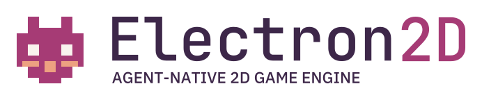
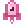
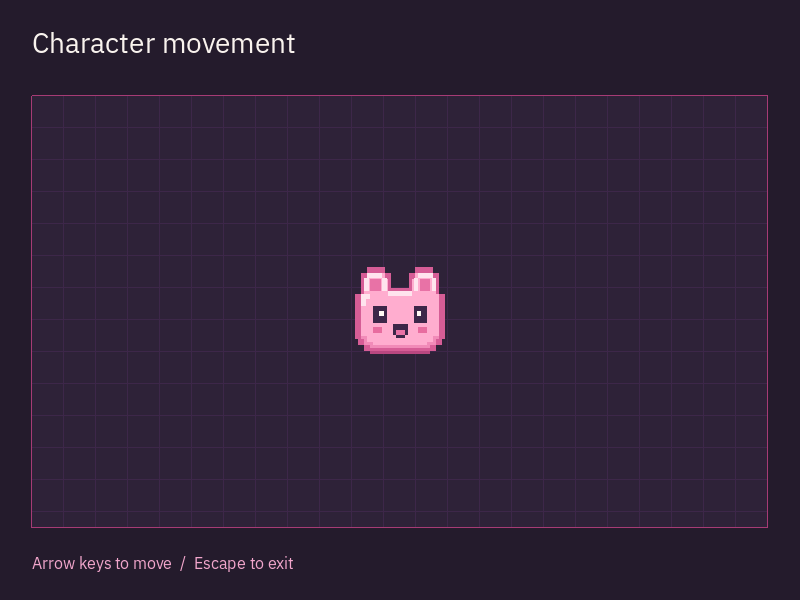

<p align="right"><a href="README.md">English</a> · <a href="README.ru.md">Русский</a> · 简体中文 · <a href="README.es.md">Español</a> · <a href="README.pt-BR.md">Português (BR)</a></p>

<h1 align="center">
  <picture>
    <source media="(prefers-color-scheme: dark) and (max-width: 480px)" srcset="docs/design/assets/sprite/logo-compact-dark.svg">
    <source media="(prefers-color-scheme: light) and (max-width: 480px)" srcset="docs/design/assets/sprite/logo-compact-light.svg">
    <source media="(prefers-color-scheme: dark)" srcset="docs/design/assets/sprite/logo-primary-dark.svg">
    <source media="(prefers-color-scheme: light)" srcset="docs/design/assets/sprite/logo-primary-light.svg">
    
  </picture>
</h1>

<p align="center">
  <a href="#installation"></a>
  <a href="#license"></a>
  <a href="https://github.com/edwardgushchin/Electron2D/releases"></a>
</p>

<p align="center">
  <a href="https://github.com/edwardgushchin/Electron2D/commits/main"></a>
  <a href="https://github.com/edwardgushchin/Electron2D/actions/workflows/ci.yml"></a>
  <a href="https://github.com/edwardgushchin/Electron2D/actions/workflows/ci.yml"></a>
</p>

<p align="center">
  <a href="#quick-start">开始使用</a> ·
  <a href="#philosophy">设计理念</a> ·
  <a href="#features">功能</a> ·
  <a href="#platforms">平台</a> ·
  <a href="#documentation">文档</a> ·
  <a href="#feedback-and-contributing">参与</a>
</p>

<p align="center">⭐ <a href="https://github.com/edwardgushchin/Electron2D">在 GitHub 上为我们点亮 Star</a> - 这会给我们很大的动力！</p>

<a id="about"></a>

##  关于项目

Electron2D 是一款**开源、跨平台的 C# 2D 游戏引擎，供开发者与 AI 智能体共同开发游戏**。

使用熟悉的 .NET 工具创作游戏世界和玩法，可以独立开发，也可以与编程助手协作。

<a id="philosophy"></a>

## 设计理念

Electron2D 以**节点树 — node-tree** 为基础。节点可以表示角色、图像、声源、计时器或界面元素。组合节点即可定义游戏对象的组成；引擎负责活动层级的生命周期、帧处理和输入。

例如，一个角色可以由以下部分组成：

```text
Player (CharacterBody)
├── Sprite
├── CollisionShape
├── AudioStreamPlayer
└── Timer
```

角色的移动与碰撞、图像、声音和计时器分别由不同节点承担。你可以替换外观、添加武器或修改声音，同时保留其余结构。节点树让对象的组成清晰可见，也有助于划分各部分的职责。

树中的一个分支可以保存为**可复用的场景**，并在游戏的不同位置创建实例。场景可以是按钮、武器、敌人，也可以是完整关卡。小场景组合成更大的游戏系统。

这一方式还遵循三个原则：

- **常规的强类型 C#。** 游戏逻辑使用 .NET 的类、属性和事件。熟悉的 IDE 工具可以帮助发现类型错误、了解 API 和修改代码。
- **专注于 2D。** 场景、摄像机、图形、物理和工具围绕二维游戏的需求设计。
- **开发者与智能体共享一个项目。** 架构旨在让双方通过共同的编辑、构建、运行和结果验证操作，处理同一套场景、资源与代码。

<a id="features"></a>

##  功能

场景和游戏逻辑使用 C# 创建。其他任务可以使用以下工具。

### 世界、画面与游戏机制

- **[场景与关卡](docs/domains/scene.md)。** 通过节点层级组合角色、物品和关卡；保存场景并再次创建实例。事件、分组、计时器和延迟调用可用于组织逻辑。
- **[图形与摄像机](docs/domains/rendering.md)。** 精灵与图集、图形与文字、视差、裁剪和独立视口，可用于游戏世界、小地图和多摄像机画面。
- **[着色器与特效](docs/components/shader-materials.md)。** HLSL/GLSL 材质、[可视化着色器图](docs/components/visual-shaders.md)、光照、阴影、HDR 和 CPU/GPU 粒子，可用于定制对象与环境的外观。
- **[地图](docs/components/tiles.md)与[几何体](docs/components/meshes.md)。** 方形、等距和六边形网格、动画图块、地形连接、碰撞层与导航层。网格可以通过程序生成，并以多个实例绘制。
- **[动画](docs/components/scene-animation.md)。** 逐帧与属性动画、贝塞尔曲线、补间、混合和状态机；[骨骼与 IK](docs/components/skeletal-animation.md)用于骨骼控制与角色变形。
- **[物理](docs/domains/physics.md)。** CPU 与独立 GPU 后端提供刚体、可控制角色、触发区域、力、关节和弹簧。射线与形状查询可用于检测周围环境和碰撞。
- **[寻路](docs/domains/navigation.md)。** 图与网格上的 A-star、导航区域与连接、从几何体烘焙导航、路径跟随和避障，可用于游戏角色移动。

### 界面与玩家交互

- **[界面与文本](docs/domains/scene.md)。** 使用按钮、列表、树、容器和文本框组合菜单、HUD、背包与对话界面。提供主题、滚动、文本和代码编辑器、富文本、Unicode、双向排版及后备字体。
- **[输入](docs/domains/input.md)与[窗口](docs/domains/display.md)。** 键盘、鼠标、触摸、手柄、动作映射和 IME 输入。支持窗口与全屏模式、缩放、多窗口，以及嵌入式或原生弹出窗口。
- **[音频](docs/domains/audio.md)与[视频](docs/components/video-playback.md)。** 位置音效、音频总线、混音、效果、麦克风和程序化音频流；播放带声音的 Ogg Theora 视频。[影片录制](docs/components/movie-writing.md)可不受实时速度限制，将画面与声音保存为 PNG/WAV、AVI 或 OGV。
- **[本地化](docs/domains/localization.md)与[无障碍](docs/components/accessibility.md)。** 翻译、上下文、复数形式、PO/MO 目录和本地化资源。Linux AT-SPI 提供界面语义，并支持操作、文本和滚动；其他平台适配器仍在开发中。

### 资源、网络与开发工具

- **[资源与场景保存](docs/domains/resources.md)。** 类型化加载、后台加载、将场景与资源一同保存，以及 [PCK/ZIP 资源包](docs/components/resource-packs.md)。图像、渐变、曲线和噪声纹理可作为程序化内容的基础。
- **[文件、设置与后台任务](docs/domains/core.md)。** JSON/XML、配置文件与文件输入输出，可用于设置和游戏存档数据。提供压缩、加密、ZIP 归档、数学、随机数、工作线程和运行时诊断。
- **[网络与多人游戏](docs/domains/networking.md)。** TCP/UDP、TLS/DTLS、HTTP/HTTPS、WebSocket、ENet 和 WebRTC。联网游戏对象可以使用 RPC、节点权限、对象生成和[属性复制](docs/components/scene-replication.md)。
- **[GPU 计算与底层图形](docs/components/local-compute.md)。** RenderingDevice 提供缓冲区、纹理、计算管线和图形管线，可用于自定义 GPU 算法与程序化数据处理。
- **[共享项目与结果验证](docs/components/project-jobs.md)。** 共享未保存的场景和 C# 代码、变更历史、不可变快照的构建与运行，以及真实帧捕获。当前配置要求 Linux；捕获需要原生窗口和渲染器。

着色器材质、GPU 粒子、带阴影的光照和 HDR 需要 GPU 渲染器。支持范围取决于平台和所选后端；确切能力与限制见以上链接及[平台报告](docs/platform-verification.md)。

<a id="agent-support"></a>

## 智能体提供商与客户端

已在 Linux 上验证编辑器与 Codex CLI 集成的有限工作流程。其他客户端的支持仍在开发；当前能力与计划列于[支持表](docs/components/project-agent.md#provider-and-client-support)。

常规开发和游戏构建无需智能体。

<a id="quick-start"></a>

##  快速开始

<a id="installation"></a>

安装 [.NET 10 SDK](https://dotnet.microsoft.com/download/dotnet/10.0) 和 Git，然后在 Windows、Linux 或 macOS 上运行示例：

```bash
git clone https://github.com/edwardgushchin/Electron2D.git
cd Electron2D
dotnet run --project examples/CharacterMovement
```

程序将打开一个角色位于网格上的场景。使用方向键移动；修改 `Player.cs` 中的速度后再次运行示例。

<a id="examples"></a>



<a id="use-electron2d-in-your-game"></a>

创建自己的游戏，以及在手机、电视或浏览器中运行的方法，见 [CharacterMovement 指南](examples/CharacterMovement/README.md)。

<a id="platforms"></a>

##  平台

| 平台 | 当前验证情况 |
| --- | --- |
| Windows | 自动化检查；视觉验收尚未完成 |
| Linux | 已在 x64 验证窗口、输入与渲染；ARM64 已执行自动化检查 |
| macOS | 自动化检查；视觉验收尚未完成 |
| Android | 已在一部 ARM64 手机上验证启动、场景和触摸控制 |
| Android TV | 已在一台 32 位电视上验证启动和遥控器控制 |
| iOS | 已在模拟器中检查原生库；渲染与真实设备尚未验证 |
| tvOS | 已在模拟器中检查原生库；渲染与真实设备尚未验证 |
| Web | 已在本地 Chrome 中验证示例与输入 |

确切配置与限制列于[平台报告](docs/platform-verification.md)。

<a id="development"></a>

##  项目状态

**Alpha：**公共 API 仍在演进，可能在版本之间发生变化。

可以使用 C# 创建游戏。可视化编辑器仍在开发中；已有工作流程见[编辑器文档](docs/components/project-jobs.md)。

<a id="documentation"></a>

##  文档

- [子系统指南](docs/README.md)
- [API 参考](docs/inventory.md)
- [着色器准备](tools/shaders/README.md)

<a id="feedback-and-contributing"></a>

##  参与项目

通过 [GitHub Issues](https://github.com/edwardgushchin/Electron2D/issues) 报告问题和提出功能建议。报告问题时请附上最小示例、引擎版本与系统信息。

<a id="contributors"></a>

参与流程见[贡献指南](CONTRIBUTING.md)。

<a id="license"></a>

##  许可证

[MIT](licence/Electron2D-LICENSE.txt)。可用于开源和商业项目。第三方许可证位于 [licence 目录](licence)。
